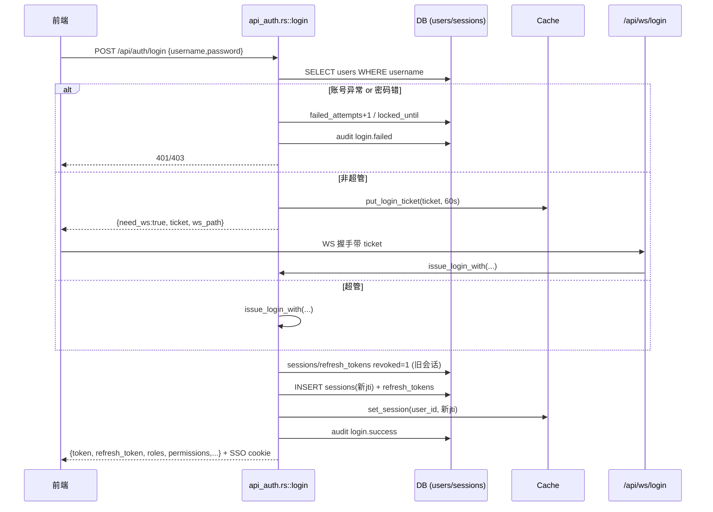
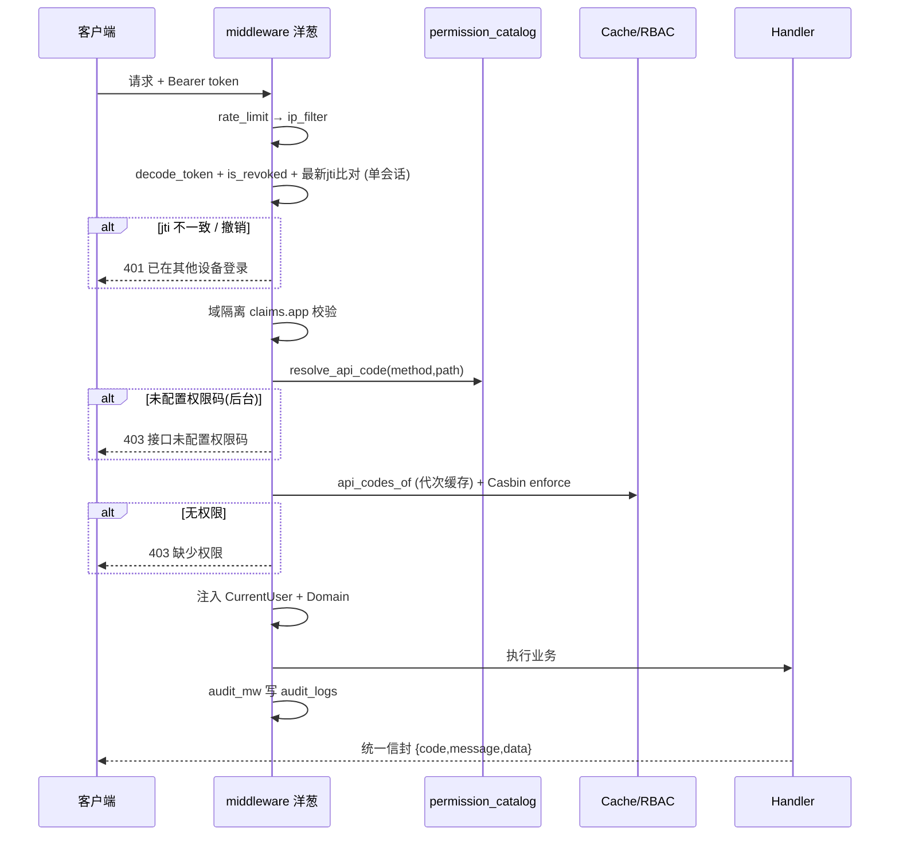
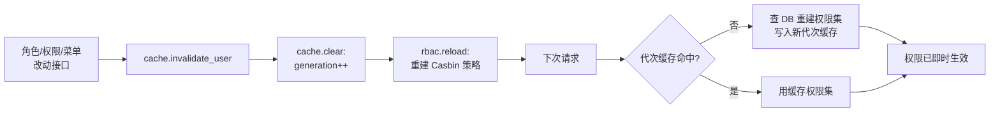
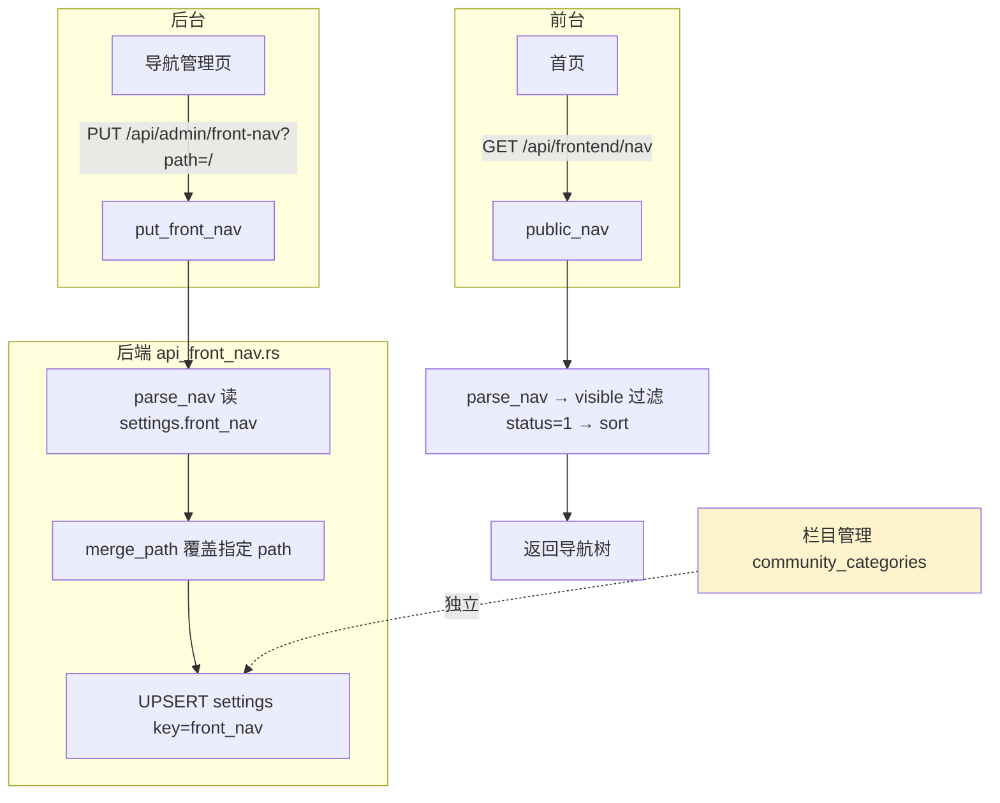
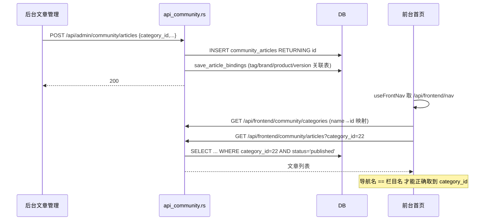
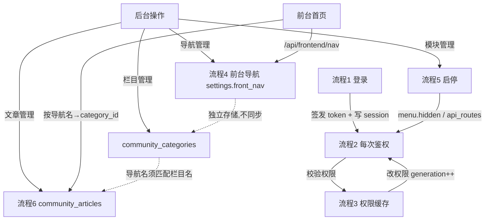

# CircleStudio 后台核心业务流程关系

  

> 范围：Rust 后端（`/root/project/rust/CircleStudio`）的**业务流程链路**。

> 配套文档：架构分层见 [backend-architecture.md](./backend-architecture.md)。

> 编写原则：每条流程采用「入口 → 核心处理 → 输出」三段式证据链，所有接口路径 / 表名 / 字段名 / 函数名均来自源码，不臆造；每条流程只配 1 张最关键的图，其余用文字串联。

  

---

  

## 流程总览

  

| # | 流程 | 触发入口 | 核心落库 / 状态变化 |

|---|---|---|---|

| 1 | 登录与令牌签发 | `POST /api/auth/login` | `sessions`/`refresh_tokens`/`sso_sessions` 旧会话 `revoked=1`，新会话写入；缓存 `set_session` |

| 2 | 鉴权请求处理 | 每次 `/api/admin*`、`/api/frontend*` 请求 | 只读校验；命中后注入 `CurrentUser`；空闲超时写 `login.timeout` 审计 |

| 3 | 权限变更 → 缓存刷新 | 角色/权限/菜单改动接口 | `cache.invalidate_user` → `generation++`；`rbac.reload()` 重建 Casbin |

| 4 | 前台导航读写 | 后台 `PUT /api/admin/front-nav`；前台 `GET /api/frontend/nav` | 写 `settings.front_nav`（JSON）；前台只读 `status=1` 项 |

| 5 | 模块启用 / 禁用 | `POST /api/admin/modules/{code}/enable\|disable` | enabled：解析 `manifest.yaml` 落 `menu`/`permissions`/`api_routes` + 跑 `schema.sql`；disabled：`menu.hidden=1` |

| 6 | 文章发布 → 前台展示 | 后台 `POST /api/admin/community/articles`；前台 `GET /api/frontend/community/articles` | 写 `community_articles` + 关联表；前台按 `category_id` 过滤 `status='published'` |

  

---

  

## 1. 登录与令牌签发

  

**入口**：`POST /api/auth/login` → `src/api_auth.rs::login`（L42）。

  

**核心处理**（`login` → `issue_login_with` L166）：

1. 取 IP（`x-forwarded-for` 优先，回退 TCP 地址）与 UA、客户端类型 `client_info::detect`。

2. 查 `users` 校验账号是否存在 / 删除 / 停用 / 锁定（`locked_until`）。

3. 密码错误：`failed_attempts+1`，达到 `max_login_fails` 则写 `locked_until`，记 `login.failed` 审计。

4. **非超管走 WS 二次握手**：`rbac::is_super` 为假时，不直接发令牌，而是写一次性登录票据到缓存（`put_login_ticket`，60s 单次），返回 `{need_ws:true, ticket, ws_path:"/api/ws/login"}`；前端须先完成 `/api/ws/login` 握手才能换令牌。

5. 超管或 WS 握手通过后进入 `issue_login_with`：

   - 清零 `failed_attempts`/`locked_until`，写 `last_login_*`。

   - 会员过期自动降级 `vip_level=0`。

   - **单点登录**：`UPDATE sessions SET revoked=1` + `UPDATE refresh_tokens SET revoked=1`（该用户全部旧会话失效）。

   - 生成 `access_jti`，写 `sessions`、缓存 `set_session(user_id, jti)`；非 legacy 模式下镜像到 `yauth_accounts`/`yauth_sessions`、`sso_sessions`。

   - `issue_token` 签发 access + refresh（HS256，`auth.rs` L79），refresh 哈希落 `refresh_tokens.token_hash`。

   - 取 `roles` + `permissions`（`rbac::permissions_of`，backend 域）一并返回。

   - 记 `login.success` 审计，`metrics.login_success+1`。

6. 响应附加 SSO cookie（`sso_cookie`，refresh TTL）。

  

**输出**：`{ token, refresh_token, expires_at, user_id, username, nickname, is_super, roles, permissions, vip_level }`，非超管分支返回 `need_ws + ticket`。

  



  

**证据锚点**：`src/api_auth.rs`（`login` L42、`issue_login_with` L166、`refresh` L337、`logout` L382）；`src/auth.rs::issue_token`；`src/middleware.rs` 空闲超时分支（见流程 2）。

  

---

  

## 2. 鉴权请求处理（每次受保护请求）

  

**入口**：所有 `/api/admin*`、`/api/frontend*` 路由组，由 `src/router.rs` 通过 `.route_layer(guard_layer)` 挂入；域 `Domain` 随组静态注入（admin=Backend，frontend=Frontend）。

  

**核心处理**（`src/middleware.rs::guard`，L217）：

1. **限流 / IP 黑名单**（更外层，先于 guard）：`rate_limit`（governor 按 IP）→ `ip_filter`（DB `ip_rules` + 配置 CIDR）。

2. 取 `Authorization: Bearer` → `decode_token` 校验签名与 `exp`、`typ=access`。

3. 查 `cache.is_revoked(jti)`；再查 DB 该用户**最新未撤销** jti，与 token 中 jti 比对——不一致即「账号已在其他设备登录」（**单会话强制**）。

4. 校验用户 `status` / `locked_until`；会员过期降级写库。

5. **空闲超时**：非白名单（`IDLE_EXEMPT`，含 `/api/admin/activity`、推流、各类轮询）请求调 `cache.touch_activity`；超 `idle_minutes` 则 `idle_expire`：撤销 access/refresh/SSO、`socket.disconnect_user`、写 `login.timeout` 审计（L174-214）。

6. **域隔离**：`claims.app` 校验——Backend 只接受 `app∈{None,"admin"}`，Frontend 只接受 `{None,"frontend"}`，SSO 票据换来的 token 不可跨域（L307-317）。

7. **权限码解析（失败关闭）**：

   - Backend：`permission_catalog::resolve_api_code(method,path)`（先查 DB `api_routes`，再查 `DEFAULT_ROUTES`）；未命中且非白名单 → 拒。命中后查 `api_codes_of`（带 60s 缓存 + 代次）。

   - Frontend：`route_perm` 静态表取必需码 → 缓存权限集 + Casbin ABAC 双重校验。

8. 注入 `Extension(CurrentUser)` 与 `Extension(Domain)`，放行到 handler；内层 `audit_mw` 记 `audit_logs`。

  

**输出**：通过则 handler 执行业务；失败返回 `AppError`（401/403），由 `error.rs` 包成统一信封。

  



  

**证据锚点**：`src/middleware.rs`（`guard` L217、`ip_filter` L111、`rate_limit` L72、`idle_expire` L175、`route_perm` L388）；`src/permission_catalog.rs`（`resolve_api_code`，模型注释 L1-8）；`src/error.rs`（统一信封）。

  

---

  

## 3. 权限变更 → 缓存代次失效 → 权限刷新

  

**入口**：任何改角色 / 权限 / 菜单 / 用户-角色 / 会员权益的接口，例如 `src/api_admin.rs`（L394/L443/L482/L551…）、`src/api_permission.rs`（L266/L281）、`src/api_menu.rs`（L825）、`src/payments.rs`（L119）、定时任务 `src/jobs.rs`（L45）。

  

**核心处理**（固定两步组合）：

1. `st.cache.invalidate_user(id)` → 内部调 `cache.clear()`（`src/cache.rs` L293-326）：

   - 内存：`generation.fetch_add(1)` + 清空 `perms` map；

   - Redis：`INCR cs:perm:gen`（`GEN_KEY`）。

   - 效果：所有带代次的权限缓存 key（`cs:perm:{gen}:{uid}:{domain}`，middleware L334/375 读取）整体过期，无需逐 key 删除。

2. `st.rbac.reload(&st.pool)` → `Rbac::reload` 重建 Casbin MemoryAdapter（重新加载 `role_permissions`/`user_roles`/`vip_level_permissions`/`user_pay_permissions` → `casbin_rule`）。

  

**下次请求**（流程 2 的第 7 步）：`generation` 已变 → 权限缓存未命中 → 重新查 DB 构建权限集 → 写入新代次缓存。从而实现「改权限即时生效，无需重启」。

  



  

**证据锚点**：`src/cache.rs`（`invalidate_user` L294、`clear` L313、`generation` L299）；`src/rbac.rs::reload`；调用点 `src/api_admin.rs` L443-444 / `src/api_permission.rs` L266 / `src/payments.rs` L119-120。

  

---

  

## 4. 前台导航读写（后台保存 ↔ 前台只读）

  

> 这是「栏目管理 ≠ 导航管理」的底层数据关系：前台导航是 `settings` 表里的一份 JSON，与 `community_categories`（文章分类）完全独立，不自动同步。

  

**入口**：

- 后台读：`GET /api/admin/front-nav?path=/` → `api_front_nav.rs::get_front_nav`（L199）

- 后台写：`PUT /api/admin/front-nav?path=/` body `{item}` → `put_front_nav`（L207）

- 前台只读：`GET /api/frontend/nav` → `public_nav`（L240）

  

**核心处理**：

- 存储：`settings` 表，`key='front_nav'`，value 是整个导航树 JSON（含所有一级 path，如 `/` 社区、`/blog` 博客）。

- **写 `put_front_nav_impl`**（L220）：`normalize_generic` 修正 path/sort → `parse_nav` 读出现有 JSON → `merge_path` 用提交项**覆盖指定 path**（其它一级菜单不变）→ 序列化 `UPSERT settings`。

- **读（后台）**：`parse_nav` 解析 → `extract_path` 取出指定 path 项返回（含隐藏项，便于编辑）。

- **读（前台公开）**：`visible` 只保留 `status==1` 且名称非空 → `sort_items` 递归按 `sort` 排序 → 返回。

- 启动期幂等：`ensure_front_nav_defaults`（补全「数据库/前端」三级，写 `front_nav_seeded_v2` 标记后不再重复）、`reset_community_nav_v3`（一次性重置社区二级栏目，写 `front_nav_reset_v3` 标记）。

  



  

> 注意：上图黄色节点 `community_categories`（栏目管理写入）与 `settings.front_nav`（导航管理写入）是两套独立数据，前台导航只认后者——这正是「新建了 AI / tools 栏目但前台看不到」的根因。

  

**证据锚点**：`src/api_front_nav.rs`（`put_front_nav_impl` L220、`public_nav` L240、`merge_path` L163、`visible` L128、`ensure_front_nav_defaults` L249）；前台渲染见 React `src/pages/home/HomePage.tsx`（`useFrontNav` → `/api/frontend/nav`，导航名须与 `community_categories.name` 精确一致才能按 `category_id` 过滤）。

  

---

  

## 5. 模块启用 / 禁用（声明式模块）

  

**入口**：`POST /api/admin/modules/{code}/enable` → `api_modules.rs::enable_module`（L75）；`/disable` → `disable_module`（L103）；`/rescan` → `rescan`（L188，调 `modules.boot()` 重扫）。

  

**核心处理**（`src/services/modules.rs`）：

- **启用 `enable(code)`**：

  1. `UPDATE modules SET status='enabled'`。

  2. 解析 `modules/<code>/manifest.yaml`：

     - `menu` + `children` → upsert `menu` 表（带 `permission_code`）；

     - `routes` → upsert `api_routes`（使模块接口纳入「失败关闭」鉴权）；

     - 权限码 → upsert `permissions` / `permission_nodes`。

  3. 执行 `modules/<code>/schema.sql`（`{prefix}` 替换为 `table_prefix`，幂等建表）。

- **禁用 `disable(code)`**：仅 `UPDATE menu SET hidden=1 WHERE module=code`（菜单隐藏，**数据与表保留**，可重新启用恢复）。

- **启动扫描 `boot()`**：遍历 `modules/*/module.yaml` → upsert `modules` 表；enabled 模块走上述启用落库；disabled 模块隐藏菜单。

  

```mermaid

flowchart LR

    A[POST /api/admin/modules/{code}/enable] --> B[modules.status=enabled]

    B --> C[解析 manifest.yaml]

    C --> D[upsert menu / permissions / api_routes]

    C --> E[执行 schema.sql 建表]

    D --> F[菜单可见 + 接口受失败关闭鉴权]

    E --> F

    G[POST /disable] --> H[UPDATE menu SET hidden=1<br/>WHERE module=code]

    H --> I[菜单隐藏, 数据保留]

    J[POST /rescan 或重启] --> K[modules.boot 扫描<br/>modules/*/module.yaml]

    K --> L[enabled 启用落库 / disabled 隐藏]

```

  

**证据锚点**：`src/api_modules.rs`（`enable_module` L75、`disable_module` L103、`rescan` L188）；`src/services/modules.rs`（约定注释 L1-25、`ModuleManager`）；清单示例 `modules/community/module.yaml` + `modules/community/manifest.yaml`；handler 编译在核心 `src/api_community.rs` / `src/api_blog.rs`（模块只控制显隐与权限，不动态加载二进制）。

  

---

  

## 6. 社区文章发布 → 前台展示

  

**入口**：

- 后台发布：`POST /api/admin/community/articles` → `api_community.rs::admin_create_article`（L1046）

- 前台列表：`GET /api/frontend/community/articles?category_id=N` → `front_articles`（L1093）

- 前台栏目：`GET /api/frontend/community/categories` → `front_categories`（L1081）

  

**核心处理**：

- **发布**：校验 `category_id>0` → `INSERT community_articles (title, summary, content, cover, category_id, author_id, status, ...) RETURNING id` → `save_article_bindings` 写关联表 `community_article_tag` / `community_article_brand` / `community_article_product` / `community_article_version`（`save_article_bindings` 内还校验所选 product 的 `category_id` 必须等于文章主 `category_id`，禁止跨栏目，L398-430）。

- **前台列表** `front_articles`（L1093）→ `build_article_query`（L245）：SQL 带条件 `(? = 0 OR a.category_id = ?)`（L304-306），即 `category_id=0` 查全部、否则按栏目过滤；前台详情 `front_article_detail` 限定 `a.status='published'`（L1102）。

- **导航 → 过滤的衔接**（前端 `HomePage.tsx`）：`useFrontNav()` 取 `/api/frontend/nav` 的导航项；点击 `path='#feed'` 的项时，用导航项 `name` 在 `frontApi.listCategories()` 返回的 `name→id` 映射里查 `category_id`，再调 `front_articles?category_id=...`。因此**导航项名称必须与 `community_categories.name` 精确一致**才能正确过滤。

  



  

**证据锚点**：`src/api_community.rs`（`admin_create_article` L1046、`save_article_bindings` L398+、`front_articles` L1093、`build_article_query` L245 / L304、`front_categories` L1081）；前台 `src/pages/home/HomePage.tsx`（`catNameToId` 映射 + 按 `category_id` 过滤）。

  

---

  

## 附：流程间的关系图（一图看懂数据如何流转）

  



  

---

  

*文档结束。如需补充某条流程（如站内信发送、订单支付、SSO 票据流转、文件上传）的链路图，或把某条拆细到字段级，告诉我即可。*